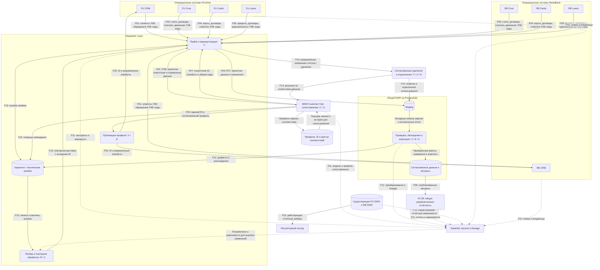

# Потоки данных через 3 месяца

Сплошные стрелки показывают данные, пунктирные — метаданные.
FU/RB обозначают FinUnion и RetailBank.



## Пояснения

- Integration Layer обозначает адаптеры, маршрутизацию и проверки. Это не одна общая БД.
- Карантин дефектных данных и очередь технических ошибок показаны одним блоком для читаемости, но имеют разные правила обработки и ответственных.
- F07 поступает через интеграционный слой в DWH и не направляется обратно на повторное сопоставление клиентов.
- F14 представляет управляющее бизнес-решение об изменении данных, а не произвольную команду удаления.
- DataHub получает метаданные, а не копии клиентских и финансовых записей.
- Действующие загрузки FU/RB DWH сохраняются. Они показаны укрупнённо, поскольку на первом этапе не переключаются.
- RB BI может продолжать локальную работу с RB DWH. Общая управленческая отчётность публикуется через FU BI.
- Полные маршруты, режимы обмена и контрольные правила приведены в data-flows.md и data-flow-management.md.
```
