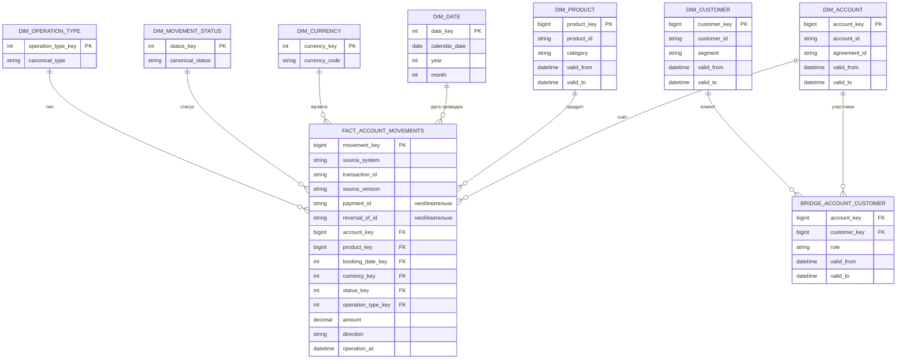

# Аналитическая модель учётных движений

## Выбор

Используется схема «звезда».

Область — учётные движения по счетам. Она продолжает определение транзакции из Task1 и использует данные Core из Task2.

Звезда упрощает запросы BI: измерения содержат понятные бизнес-атрибуты, а факт — ключи и меры. Историчность справочников сохраняется в измерениях.

## Детализация факта

Одна строка fact_account_movements — одно учётное движение Core по одному счёту.

Бизнес-ключ:

«source_system + transaction_id».

Повторная доставка не создаёт новый факт. Изменения исходной записи обрабатываются по версии с сохранением аудита. Сторно является отдельным движением со ссылкой на исходную запись.

Платёж может породить несколько движений, поэтому payment_id не является уникальным ключом факта.

## Таблицы

| Таблица | Назначение | Основные поля |
| --- | --- | --- |
| fact_account_movements | Движения по счетам | movement_key; source_system; transaction_id; source_version; payment_id; reversal_of_id; account_key; product_key; booking_date_key; currency_key; status_key; operation_type_key; amount; direction; operation_at |
| dim_account | Историческое представление счёта | account_key; account_id; source_system; source_account_id; agreement_id; account_type; valid_from; valid_to; is_current |
| dim_product | Продукт и классификация | product_key; product_id; category; name; valid_from; valid_to; is_current |
| dim_date | Календарь даты проводки | date_key; calendar_date; month; quarter; year |
| dim_currency | Валюта движения | currency_key; currency_code; name |
| dim_movement_status | Согласованный статус | status_key; canonical_status; включение в опубликованные показатели |
| dim_operation_type | Тип движения | operation_type_key; canonical_type; name |
| dim_customer | Исторические атрибуты клиента | customer_key; customer_id; party_type; segment; valid_from; valid_to; is_current |
| bridge_account_customer | Клиентские роли по счёту через договор | account_key; customer_key; role; valid_from; valid_to |

dim_customer содержит только необходимые аналитические атрибуты. Паспортные данные и контакты в эту модель не включаются.

## Диаграмма

## Почему клиент связан через bridge

В Task1 договор может иметь нескольких участников. Прямая связь каждого движения с единственным клиентом потеряла бы эту особенность.

bridge_account_customer строится по связи:

«счёт → договор → участник договора».

Присоединение всех участников размножает строки факта. Поэтому:

- общие обороты считаются непосредственно по факту;
- фильтрация по клиенту использует проверку наличия связи либо уникальные ID движений;
- распределение суммы между участниками возможно только по отдельному бизнес-правилу;
- BI не суммирует результат произвольного JOIN с bridge.

## Историчность

Для счёта, продукта и клиента используется хранение версий с периодами действия, где изменение атрибутов важно для анализа.

Факт связывается с версией счёта и продукта, действовавшей на дату проводки. Клиентские роли также выбираются на соответствующую дату.

Периоды версий одного объекта не должны пересекаться. Если историческое соответствие неизвестно, оно не заменяется молча текущим значением.

## Показатели

| Показатель | Правило |
| --- | --- |
| Количество учётных движений | Число фактов с согласованными статусами; не называется количеством платежей |
| Дебетовый оборот | Сумма движений направления debit по правилам исходного учёта и согласованным статусам |
| Кредитовый оборот | Аналогично для credit |
| Количество активных счетов | Число различных account_id с включёнными движениями за период |

Обороты группируются по валюте. Пересчёт в единую валюту требует отдельного источника курсов, вида курса и даты применения; без них показатель не публикуется.

Перевод между внутренними счетами создаёт несколько движений. Сумма всех движений не называется объёмом уникальных платежей.

Корректировки и сторно учитываются по утверждённой методике. Нельзя одновременно исключить исходное движение и повторно вычесть его сторно.

## Отдельные факты

Остатки и кредитная задолженность не помещаются в факт движений:

- fact_account_balance — счёт × дата снимка;
- fact_loan_snapshot — кредит × дата снимка.

Остатки можно агрегировать между сопоставимыми счетами на одну дату, но нельзя складывать по разным датам как обороты.

## Проверки перед публикацией

- Уникальность source_system + transaction_id в текущем представлении.
- Отсутствие повторов одной версии.
- Разрешение обязательных ссылок.
- Единственная подходящая историческая версия измерения.
- Сверка количества и финансовых итогов с Core.
- Отсутствие размножения строк при соединениях.
- Явная дата актуальности и контрольная точка набора.
