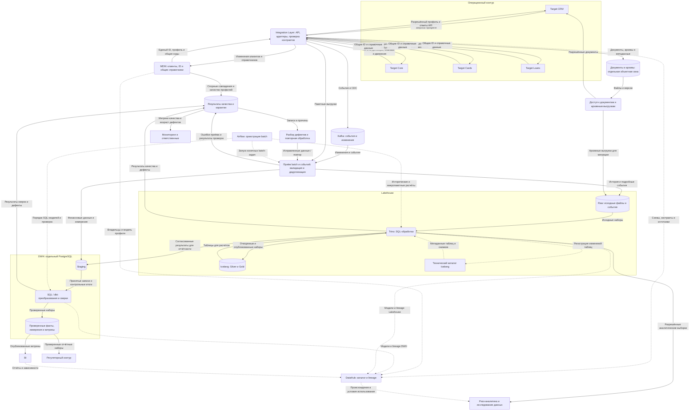

# Целевая архитектура данных

Сплошные стрелки показывают бизнес-данные.
Пунктирные — управление выполнением и метаданные.



## Пояснения

- Целевые системы заменяют соответствующие функции legacy после подтверждённого переноса. До этого временные источники подключаются через адаптеры.
- Kafka используется для доставки изменений. Долгосрочная история хранится в DWH и Lakehouse по назначению.
- Блок приёма включает отдельные batch-задачи и постоянно работающие обработчики. Airflow управляет только конечными задачами.
- Raw, Iceberg и документная зона могут использовать общую технологию объектного хранения, но имеют разные права и политики.
- Запись в Iceberg выполняется через совместимый движок и каталог; блок Iceberg обозначает управляемые таблицы.
- Карантин и результаты качества показаны укрупнённо. Их физическое хранение и доступ разделяются по чувствительности.
- Повторная обработка направляется по типу сущности в исходный маршрут, включая MDM для клиентских данных.
- Регуляторный контур переключается на целевой DWH только после параллельного расчёта и сверки.
```
